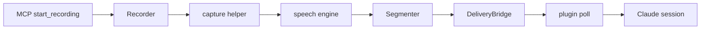

# DMMF implementation plan: meeting-voice-mcp v1

Technical modeling note (not the plan of record). Model: `docs/domain-model/data/*.json`. Repository: nowly-lab/meeting-voice-mcp, base `949a775`. Paths below are planned until the tasks create them.

## Implementation Slice
Record → transcribe → segment → deliver → stop/save, for one meeting at a time on one Mac.

## Workflow State
- Meeting: `MeetingMeta.status` = `recording | stopped | saved` (`src/store/store.ts` `MeetingMeta`).
- Segment: derived from `segments.jsonl` events = `sealed | claimed | delivered` (`src/bridge/bridge.ts` `DeliveryBridge`).

## State Transitions
See `docs/domain-model/workflow-models.html`. Meeting: recording -(stop)-> stopped -(compress)-> saved; start while recording is refused. Segment: sealed -(poll/claim)-> claimed -(ack)-> delivered; claimed -(30 s)-> sealed with `resent`.

## Pipeline Steps
1. Parse MCP args with Zod (`src/mcp/tools.ts`).
2. `Recorder.start` creates the meeting, starts capture and the engine (`src/meeting/recorder.ts`).
3. Engine emits voice/text callbacks → `Recorder.addUtterance` appends (`MeetingStore.appendUtterance`).
4. `Segmenter.tick` seals → `MeetingStore.appendSegmentEvent(sealed)` → `DeliveryBridge.enqueue`.
5. Plugin `poll` → claim (event saved) → `deliverSegments` → `ack` (event saved).
6. `Recorder.stop` flushes, then `compressAudio`.

## Dependencies And Edges
Injected at composition (`src/server.ts`): `MeetingStore` (persistence model), `startCapture` (process), engine factories (sherpa worker / Gemini Live), `clock`, `events` (SSE). Bound in closures; core classes take plain objects.

## Error / Effect Model
- Expected outcomes as values: `start` while recording → MCP `isError` with the meeting named; missing `GEMINI_API_KEY` → `isError`, no meeting created; system audio denied → status `denied`, recording continues.
- Adapter errors: HTTP 421 bad Host, 403 Origin/nonce, 401 token, 400 Zod parse.
- Unexpected throws: capture helper crash → status error, meeting stopped as interrupted.

## Serialization / Persistence Impact
Zod schemas at `/mcp`, `/api/bridge/*` and the helper's JSON lines. Persistence: append-only jsonl per meeting; claim/ack are appended as events in the same write as the in-memory state change (single process, append then mutate). No database.

## TypeScript Implementation Example
```ts
const StartRecording = z.object({ title: z.string().max(200).optional(), instructions: z.string().max(4000).optional(),
  engine: z.enum(["parakeet", "gemini"]).optional(), language: z.string().max(16).optional(),
  sources: z.array(z.enum(["mic", "system"])).min(1).optional(), silence_seconds: z.number().int().min(1).max(30).optional() }).strict();
```

## Mermaid Diagrams


## Tests
Per plan tasks: `test/store.test.ts`, `test/segmenter.test.ts`, `test/bridge.test.ts`, `test/capture.test.ts`, `test/parakeet.test.ts`, `test/gemini-live.test.ts`, `test/recorder.test.ts`, `test/server.test.ts`, `test/tools.test.ts`, `test/web.test.ts`, `plugin/hooks/register.test.ts`.

## Open Questions
Gemini Live text-only transcription settings (Task 6 spike); permission attribution of a background server (Task 4 device check).
