# Soniox engine: implementation plan (DMMF)

Repository nowly-lab/meeting-voice-mcp, from `main` 8056fae. The plan of record is linked from the pull request. Current model: [`docs/domain-model/`](../../../docs/domain-model/index.html) (stickies `ext-soniox`, `hs-soniox`, `cmd-transcribe`, `pol-utterance`, `agg-meeting-2`, `cmd-stop`).

## 1. Implementation Slice

`start_recording { engine: "soniox" }` → per-side Soniox WebSocket → utterances on the recording timeline → existing segmenter and delivery. Also: capture timing jitter under 20 ms is not an audio gap, and `stop_recording` returns a summary.

## 2. Workflow State

Per side (`SideState` in `src/speech/soniox.ts`): `socket`, `generation` (connection counter), `anchors` and `sentMs` (Soniox time → recording time; a new anchor whenever a chunk does not start where the previous one ended), `buffer` (audio waiting during a reconnect), `reconnecting`, `failures` (in a row, cleared when text arrives), `dead` (fatal error), and the open utterance `text`/`startMs`/`endMs`.

## 3. State Transitions

```mermaid
stateDiagram-v2
  [*] --> Connected: open() ok
  [*] --> [*]: open() fails → reject naming SONIOX_API_KEY
  Connected --> Reconnecting: any close while recording / error 408 413 429 500 503
  Reconnecting --> Connected: open() ok, buffered audio resent, anchors reset
  Reconnecting --> Reconnecting: open() fails → capped backoff; error() once after 5 failures in a row
  Connected --> Dead: error 400 401 402 403 → error(), no retry
  Connected --> Finishing: stop()
  Finishing --> [*]: finished:true or finishWaitMs → emit, close
```

## 4. Pipeline Steps

1. `write(side, pcm, atMs)`: VAD gets the audio; the socket gets it (or the buffer while reconnecting); an anchor is added when `atMs` is not where the sent audio ends. A side with no audio for 15 s gets a keepalive.
2. `onMessage`: zod-parse the message; error codes branch as above; final tokens append text with times converted through the anchors; `<end>` emits one utterance; non-final tokens are ignored.
3. VAD `voice(false)` → `cb.pending(side, at)` so the segmenter waits up to `TRANSCRIPT_WAIT_MS` (5 s) for the text.
4. `stop()`: send an empty text frame, wait for `finished` or `finishWaitMs` (3 s), emit what is left, close.

## 5. Dependencies And Edges

`SonioxConnect` (default: `ws` with `Authorization: Bearer`, config message with `model`, `pcm_s16le`, 16 kHz mono, `language_hints`, `enable_endpoint_detection`), `VadFactory` (Silero via `createParakeet(..., { vadOnly: true })`). Bound in `defaultEngines` (`src/server.ts`) from `SONIOX_API_KEY` and `MEETING_VOICE_SONIOX_MODEL`.

## 6. Error / Effect Model

Missing key: thrown by `defaultEngines` before a meeting exists (MCP isError). First connection failure: `createSoniox` rejects naming `SONIOX_API_KEY`. Runtime: `cb.error(message)` shown on the status and live page; fatal codes stop that side; other errors and closes reconnect with a capped backoff (500 ms doubling to 8 s), reported once after 5 failures in a row. Text that was sent to a replaced connection but not yet final is lost (accepted).

## 7. Serialization / Persistence Impact

`MeetingMetaSchema.engine` gains `"soniox"` (older meetings stay valid). `/api/status` gains `soniox: boolean`. `stop_recording` returns `MeetingSummary` (`src/mcp/tools.ts`, `meetingSummary`).

## 8. TypeScript Implementation Example

See `createSoniox` and `defaultConnect` in `src/speech/soniox.ts`; `meetingSummary` in `src/mcp/tools.ts`; `GAP_JITTER_MS` in `src/meeting/recorder.ts`.

## 9. Mermaid Diagrams

Section 3.

## 10. Tests

`test/soniox.test.ts` (per-side connections, holes in the sent audio, repeated errors back off and report once, retries never give up while recording, close 1000 reconnects, stop during a reconnect, stop does not wait after a close, keepalives, `defaultConnect` against a local WebSocket server, `<end>` joining with offset, VAD pending, reconnect with buffered audio and stale messages, 413 reconnect, 401 no retry, 402 message, malformed message, failed first connect, stop flush with and without `finished`, real Soniox when `MEETING_VOICE_REAL_SONIOX=1`); `test/server.test.ts` (`defaultEngines` refuses soniox without a key; MCP isError); `test/recorder.test.ts` (soniox waits for pending text; jitter is not a gap); `test/tools.test.ts` (summary keys); `test/web.test.ts` (Soniox check row and history label).

## 11. Open Questions

Accuracy of Japanese and the `<end>` delay with a real key (hotspot `hs-soniox`); checked once the key is available.
